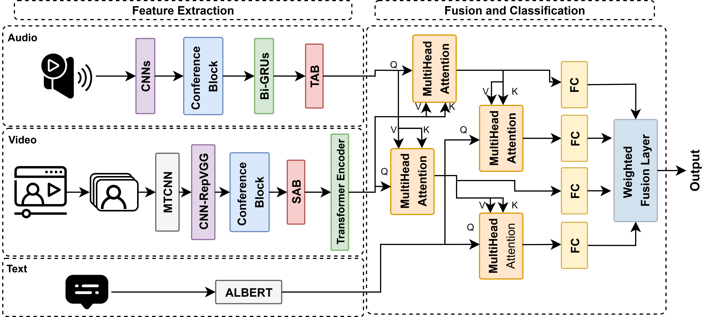
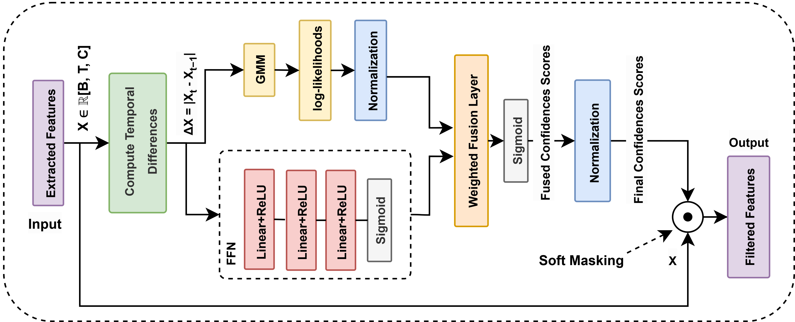
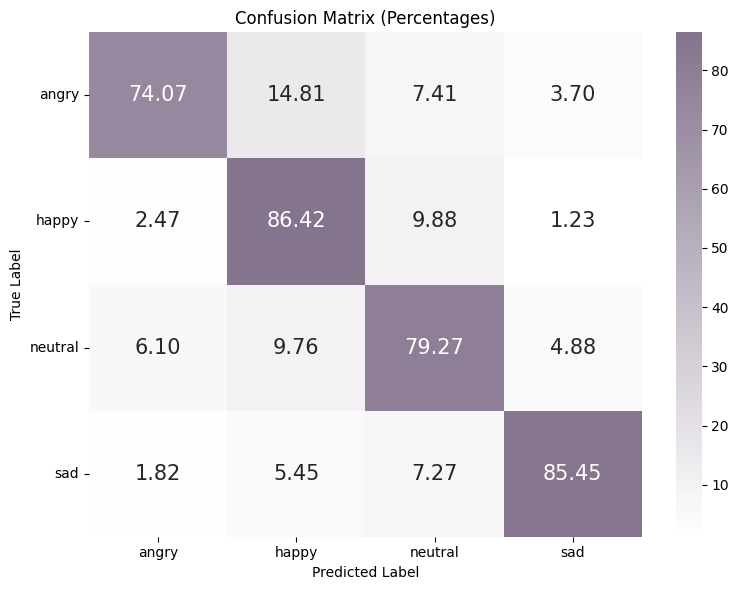

<!-- PROJECT LOGO -->
<br />
<div id="readme-top" align="center">
  <a href="https://github.com/InesJemmali/Hybrid-Confidence-Guided-Feature-Selection-for-Enhanced-Multimodal-Emotion-Recognition">
    
  </a>

  # AV-FLARE: Feature-Level Reliability Estimation for Multimodal Emotion Recognition

  <p align="center">
    Official implementation of the paper submitted to UAI 2026
    <br />
    <strong>"AV-FLARE: Feature-Level Reliability Estimation for Multimodal Emotion Recognition"</strong>
    <br />
  </p>
</div>

<div align="center">

[](#readme)

</div>  

<div align="center">
    <p align="center">
    ·
    <a href="https://github.com/InesJemmali/Hybrid-Confidence-Guided-Feature-Selection-for-Enhanced-Multimodal-Emotion-Recognition/issues">Report Bug</a>
    ·
    <a href="https://github.com/InesJemmali/Hybrid-Confidence-Guided-Feature-Selection-for-Enhanced-Multimodal-Emotion-Recognition/issues">Request Feature</a>
  </p>
</div>

---

## Overview

Multimodal Emotion Recognition (MMER) benefits from combining speech, facial expressions, and text, but real-world signals are often noisy and unreliable. AV-FLARE introduces **explicit feature-level reliability estimation** to address this issue.

Key contributions:

- **Feature-level reliability estimation:** Computes per-frame and per-channel reliability for audio and visual streams.
- **Hybrid reliability modeling:** Combines supervised FFN (local temporal variations) and unsupervised GMM (global statistical patterns).
- **Early reliability modulation:** Reweights representations before temporal modeling to suppress unreliable features.
- **Hierarchical cross-modal fusion:** Integrates audio, visual, and text modalities with attention mechanisms.
- **Composite loss:** Jointly optimizes classification and reliability alignment.
- **Competitive performance:** Strong results on the IEMOCAP benchmark.

---

## Contents
<details>
  <summary>Table of Contents</summary>
  <ol>
    <li><a href="#abstract">Abstract</a></li>
    <li><a href="#built-with">Built With</a></li>
    <li><a href="#model-architecture">Model Architecture</a></li>
    <li><a href="#dataset">Dataset</a></li>
    <li><a href="#evaluation-metrics">Evaluation Metrics</a></li>
    <li><a href="#experimental-results">Experimental Results</a></li>
    <li><a href="#comparison-with-state-of-the-art">Comparison with State-of-the-Art</a></li>
    <li><a href="#installation">Installation</a></li>
    <li><a href="#usage">Usage</a></li>
    <li><a href="#project-structure">Project Structure</a></li>
    <li><a href="#paper-reference">Paper Reference</a></li>
    <li><a href="#license">License</a></li>
  </ol>
</details>

---

## Abstract

Multimodal emotion recognition leverages complementary modalities but remains challenging due to modality-specific noise and unreliable audio-visual features. We propose AV-FLARE, a feature-level reliability estimation framework that modulates representations before temporal modeling. It estimates per-frame and per-channel reliability scores using a supervised feedforward network capturing short-term emotional transitions and an unsupervised Gaussian Mixture Model modeling global statistical structure. Their outputs are fused to produce reliability-aware masks applied to modality representations. Filtered features are encoded by modality-specific networks and fused via hierarchical cross-modal attention, where text guides audio-visual interaction. Experiments on IEMOCAP demonstrate competitive performance, achieving 90.81% accuracy and an F1-score of 81.69%.

---

## Built With

### Tools and Libraries

- 
- 
- 
- 
- 
- 

<p align="right">(<a href="#readme-top">back to top</a>)</p>

---

## Model Architecture

AV-FLARE consists of modality-specific encoders, reliability estimation modules, and hierarchical fusion.

### Audio Modality

- **Input:** Raw waveforms
- **Feature Extraction:** 7-layer 1D CNN
- **Reliability Modulation:** Per-frame and per-channel scoring
- **Temporal Modeling:** 4-layer BiGRU + Temporal Attention Block (TAB)

### Video Modality

- **Preprocessing:** Face detection and alignment using MTCNN
- **Spatial Encoding:** RepVGG backbone + Spatial Attention Block (SAB)
- **Reliability Modulation:** Feature-level scoring
- **Temporal Modeling:** Transformer encoder

### Text Modality

- **Encoder:** Pre-trained ALBERT
- **Representation:** CLS token embedding
- **Note:** Text bypasses reliability filtering due to lower frame-level variability

### Reliability Estimation Module

Two complementary mechanisms estimate reliability:

- **Supervised FFN**
  - Uses temporal differences between frames
  - Captures local emotional dynamics

- **Unsupervised GMM**
  - Models global distribution of temporal variations
  - Detects statistically atypical patterns

- **Adaptive Fusion**
  - Combines FFN and GMM scores via learnable weights
  - Produces continuous reliability masks applied to features

### Fusion Strategy

1. Audio and visual streams interact via cross-attention  
2. Text guides multimodal integration  
3. Interaction representations are combined using weighted fusion  

### Loss Function

- **Focal Loss:** Addresses class imbalance
- **Reliability Alignment Loss:** Encourages consistency between reliability estimates and prediction errors

<p align="right">(<a href="#readme-top">back to top</a>)</p>

---

## Architecture of AV-FLARE

<p align="center">
  
</p>

---

## Reliability Estimation Module

<p align="center">
  
</p>

---

## Dataset

Experiments are conducted on the **IEMOCAP dataset**:

- Approximately 12 hours of audiovisual data
- Four emotion classes: Angry, Happy (including Excited), Neutral, Sad
- Speaker-independent protocol:
  - Sessions 1–4: Training
  - Session 5: Validation/Test split

| Emotion | Count |
|---------|--------|
| Neutral | 1,708  |
| Happy   | 1,636  |
| Angry   | 1,103  |
| Sad     | 1,084  |

Processed data can be downloaded from:

[Download Processed Data](https://hkustconnect-my.sharepoint.com/personal/wdaiai_connect_ust_hk/_layouts/15/onedrive.aspx?id=%2Fpersonal%2Fwdaiai_connect_ust_hk%2FDocuments%2FMME2E%2Fdata%2Ezip)

<p align="right">(<a href="#readme-top">back to top</a>)</p>

---

## Evaluation Metrics

- Accuracy
- Precision
- Recall
- F1-score

---

## Experimental Results

### Performance on IEMOCAP

| Emotion | Accuracy | Precision | Recall | F1-score |
|---------|----------|-----------|--------|----------|
| Angry   | 91.91%   | 83.33%    | 74.07% | 78.43%   |
| Happy   | 88.97%   | 78.65%    | 86.42% | 82.35%   |
| Neutral | 87.87%   | 80.25%    | 79.27% | 79.75%   |
| Sad     | 94.49%   | 87.04%    | 85.45% | 86.24%   |
| **Average** | **90.81%** | **82.32%** | **81.30%** | **81.69%** |

---

#### Confusion Matrix

<p align="center">
  
</p>

<p align="right">(<a href="#readme-top">back to top</a>)</p>

---

## Comparison with Recent Methods

AV-FLARE is compared with representative multimodal emotion recognition methods on the IEMOCAP dataset.

| Method | Accuracy | Precision | Recall | F1-score |
|---------|----------|-----------|--------|----------|
| M3ER (Mittal et al., 2020) | 82.7 | — | — | 82.4 |
| Liu et al., 2024 | 84.3 | — | — | 84.5 |
| Fu et al., 2024 | 82.73 | — | — | 81.48 |
| Shayaninasab & Babaali, 2024 | 75.42 | 76.1 | 75.42 | 75.35 |
| Hosseini et al., 2024 | 82.9 | — | — | — |
| Majumder et al., 2018 | 76.5 | — | — | 76.8 |
| Nfissi et al., 2025 | 88.31 | 76.53 | 76.47 | 76.43 |
| **AV-FLARE (Ours)** | **90.81** | **82.32** | **81.30** | **81.69** |

AV-FLARE achieves competitive performance across metrics, demonstrating the effectiveness of explicit feature-level reliability estimation for handling noisy multimodal inputs.


---

## Ablation Study

| Method | Accuracy | F1-score |
|--------|----------|----------|
| No Reliability | 86.40 | 73.13 |
| GMM Only | 87.32 | 75.09 |
| FFN Only | 88.42 | 76.88 |
| FFN + GMM (AV-FLARE) | **90.81** | **81.69** |

---

## Installation

1. **Clone** this repo:
   ```bash
   git clone https://github.com/InesJemmali/Hybrid-Confidence-Guided-Feature-Selection-for-Enhanced-Multimodal-Emotion-Recognition.git
   cd Hybrid-Confidence-Guided-Feature-Selection-for-Enhanced-Multimodal-Emotion-Recognition
   ```
2. **Install dependencies**:
   ```bash
   pip install -r requirements.txt
   ```

<p align="right">(<a href="#readme-top">back to top</a>)</p>

---

## Usage

1. **Configure dataset paths** in `main.py`.
2. **Train the model**:
   ```bash
   python main.py
   ```
3. **Evaluate on test set**:
   ```bash
   python main.py --test
   ```

<p align="right">(<a href="#readme-top">back to top</a>)</p>

---

## Project Structure

```
/
├── figures/                  # Visualization assets
│   ├── logo.png
│   ├── confusionmatrix.png
│   ├── confedencemodule.png
│   └── model.png
├── AV-FLARE/                      # Source code directory
│   ├── models/
│   │   ├── audio_model.py
│   │   ├── text_model.py
│   │   ├── video_model.py
│   │   ├── gmm.py
│   │   ├── confidences.py
│   │   ├── transformers_module.py
│   │   ├── mmer.py
│   │   └── attention_module.py
│   ├── trainers/
│   │   └── trainer_definitions.py
│   ├── utils/
│   │   ├── data_utils.py
│   │   ├── evaluations.py
│       └── loss_functions.py
├── notebooks/
│   ├── datasetiemocap.ipynb
│   ├── datasetmosei.ipynb
├── .gitignore               # Git ignore file
├── LICENSE
├── main.py                  # Main entry point
├── README.md
└── requirements.txt         # Dependencies
```

<p align="right">(<a href="#readme-top">back to top</a>)</p>

---

## Paper Reference

If you utilize this code, please cite:

> "AV-FLARE: Feature-Level Reliability Estimation for Multimodal Emotion Recognition"

<p align="right">(<a href="#readme-top">back to top</a>)</p>

---

## Steps to train the Model

1. **Install Git** (if not already installed).
2. **Clone the Repository**:
   ```bash
     git clone <ANONYMIZED_REPOSITORY_URL>
     cd <REPOSITORY_FOLDER>
   ```
3. **Ensure Python is Installed**:
   - Check Python version:
     ```bash
     python --version
     ```
4. **Install Required Libraries**:
   ```bash
   pip install -r requirements.txt
   ```
5. **Ensure all Paths is Correct**:
  
6. **Run the Main Script**:
   ```bash
   python main.py
   ```

<p align="right">(<a href="#readme-top">back to top</a>)</p>

---

<!-- CONTRIBUTING -->
## Contributing

We deeply appreciate any contributions that help improve this project.  The open-source community thrives on collaboration, and your input is invaluable.

To contribute, please fork the repository and submit a pull request with your suggested changes.  Alternatively, you can open an issue with the **enhancement** tag to share your ideas.  
We also appreciate you starring the project! Thank you for your support.

1. Fork the Project
2. Create your Feature Branch (`git checkout -b feature/AmazingFeature`)
3. Commit your Changes (`git commit -m 'Add some AmazingFeature'`)
4. Push to the Branch (`git push origin feature/AmazingFeature`)
5. Open a Pull Request

<p align="right">(<a href="#readme-top">back to top</a>)</p>


---

<!-- LICENSE -->
## License

All source code is made available under a [BSD 3-Clause License](https://opensource.org/license/bsd-3-clause) license. You can freely
use and modify the code, without warranty, so long as you provide attribution
to the authors. See `LICENSE.md` for the full license text.

<p align="right">(<a href="#readme-top">back to top</a>)</p>


---


